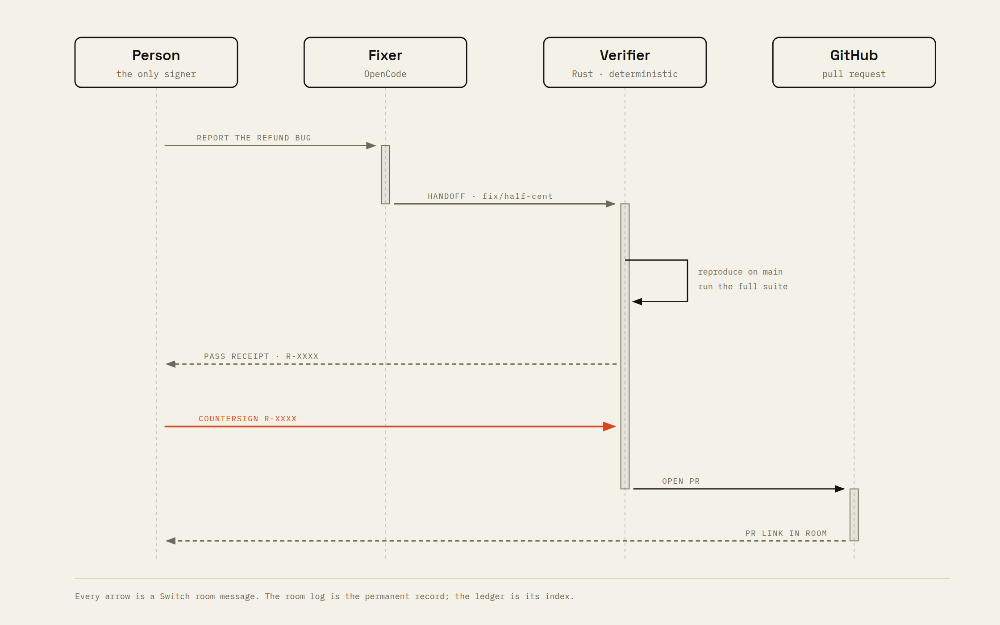
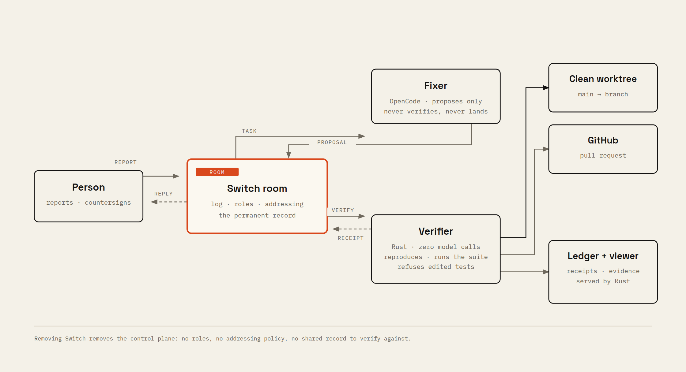

# Countersign

**No agent ships alone.**

Countersign is a Switch room where AI agents propose changes, an independent verifier proves or refutes them with reproducible evidence, and a named person countersigns before anything lands.

Built for the **Flip the Switch Hackathon** (WeMakeDevs × DevTools Academy, powered by Switch AI), **Track 01 — Best Business Workflow**.

**▶ [Watch the 66-second demo](docs/demo/countersign-demo.mp4)**



---

## The problem

Coding agents got fast. Review did not.

- Agents started **over 40% of pull requests** in September 2026 — about **110 million PRs** — up from 17% in March ([GitHub Octoverse 2026](https://github.blog/news-insights/octoverse/octoverse-commits-pushes-reach-new-highs-in-2026-as-developers-build-with-agents/)).
- Under high AI adoption, PRs are **51% larger**, median review time is up **441%**, and **31% more PRs merge with no review at all** ([Faros AI Engineering Report 2026](https://www.faros.ai/blog/ai-code-quality-senior-engineer-review-burden)).
- The most engaged #HowISwitch post described the everyday version: *"I was basically a human clipboard between Claude Code and my team's Slack… by the time I'd explained it all, half the context was lost."*

The bottleneck is not generation. It is **trust**: can a team let an agent's work land without a senior engineer redoing it in a private terminal?

Today's options are bad in opposite directions. Review tools comment but do not gate. Agent dashboards show activity but not proof. And in most agent-in-chat setups, the agent that wrote the change is also the one reporting whether it works — the agent grades its own homework, and the room has no way to tell.

**Countersign makes verification a separate job in the room.**

---

## What it does

One room. Two agents. One human decision.

```
Person        reports the failing refund total
Fixer         proposes a branch in its own checkout
Verifier      reproduces the failure on main, runs the full suite on the branch,
              refuses branches that edit their own tests, issues a receipt
Person        countersigns the passing receipt
Verifier      opens the pull request (or merges locally)
```

The rule is structural, not a prompt:

> **The proposer cannot verify. The verifier cannot write. Only a person can countersign. Only a passing receipt can be countersigned.**

That is the whole product. Everything else exists to make those four sentences true and visible.

---

## Why it is different

| Existing approach | What it does | What it cannot do |
|---|---|---|
| Coding agent in chat | Generates a change and reports its own test run | Prove the change independently; the report is self-issued |
| AI code review | Comments on a PR | Gate the landing; the decision stays outside the room |
| Agent observability dashboards | Shows what agents are doing | Produce a shareable proof that a specific change works |
| Human-in-the-loop SDKs | Pauses a workflow for approval | Keep the proposal, evidence, and signature in one team-visible record |
| **Countersign** | **A second agent that never writes, a deterministic receipt, and a human signature in the room** | — |

Countersign is not another coding agent. It is the **trust layer above one**: the thing that lets an agent's work land at chat speed without a person redoing it.

The strongest test of whether Switch is load-bearing: remove it and the product disappears. There is no room, no roles to hold, no addressing policy deciding who may ask whom, no shared log for the receipt, and no identity to attach a countersignature to. Countersign is a Switch-native control system, not a bot bolted onto a channel.

---

## The demo

The repository ships a deliberately buggy checkout service (`demo/orders`). A $19.99 refund at 50% off should return $10.00; the code truncates the half cent and returns $9.99.

Two things happen in the recorded demo:

1. **A plausible hotfix is rejected.** A teammate's one-line fix (`hotfix/naive-rounding`) adds `+ 0.5` to the float. It passes the reported test. The verifier runs the full suite and issues a **FAIL** receipt: refunds still round in the wrong direction.
2. **The real fix passes and lands.** The fixer works in an isolated copy, proposes `fix/…`, and hands off. The verifier reproduces the failure on `main`, runs all 8 tests on the branch, and issues a **PASS** receipt. The person replies `@verifier countersign R-XXXXXX`. A real GitHub pull request opens with the receipt attached.

The FAIL is not staged model output. It is a real branch, real tests, and a real receipt. The verification path contains no model.

---

## How Switch is used

Countersign is a protocol-level Switch client, not a wrapper around the Console:

| Switch capability | How Countersign uses it |
|---|---|
| **Rooms** | One channel becomes the shared record: reports, proposals, receipts, and signatures |
| **Agent protocol** | The verifier is a Rust WebSocket client (`/agents/{id}/connection/ws`), answering `ping` with `pong` + cursor and calling operations over HTTP |
| **Room operations** | `connect_to_room`, `post_message`, `list_participants` |
| **Roles** | `@fixer` (shared) and `@verifier` (exclusive). The verifier's exclusive lease means two verifiers cannot issue contradictory receipts |
| **Addressing policy** | The bootstrap opens both agents to room members; the role, not a hard-coded name, is what people address |
| **Room instructions** | The room carries the rules every agent reads on join: propose, never land; verify, never write; a person signs |
| **Room log** | The permanent record. The ledger and viewer are an index over receipts, not a second source of truth |

Multi-agent here is not decorative: the fixer and verifier are separate processes with different capabilities, different credentials, and different failure modes. The verifier is deterministic Rust; the fixer is an existing coding agent (OpenCode CLI). They genuinely cannot be one agent.

---

## Architecture



| Component | Responsibility |
|---|---|
| **Switch server + Mattermost** | Rooms, roles, addressing, shared log. Self-hosted with Docker Compose; bundled Mattermost needs no workspace admin |
| **`countersign-fixer`** | A Switch agent that drives OpenCode (or Codex) in an isolated copy of the repository. Proposes a branch, commits it, publishes it, and hands off. Cannot verify or land |
| **`countersign-verifier`** | A Rust Switch agent with zero model calls in the proof path. Creates a clean worktree, reproduces the reported failure on the base revision, runs the full suite on the branch, enforces scope, writes a receipt |
| **Ledger + viewer** | SQLite receipt ledger, a read-only Axum API, and a React proof ledger served by the same Rust process at `http://127.0.0.1:4090` |
| **GitHub** | Optional landing target: `gh pr create` with the receipt in the PR body. Falls back to a local proof branch when GitHub is unavailable |

### The verification path

The verifier does the same thing every time, with no model in the loop:

1. Resolve the branch; reject the base branch and malformed names.
2. Diff `main...branch`. Reject any branch that touches `demo/orders/tests/**` or anything outside `demo/orders/**`.
3. Create one clean worktree at `main`. Run the reported regression test. It **must fail** — otherwise the verifier refuses to certify a fix for a bug that is not there.
4. Check out the branch in the same worktree. Run the **full** suite. It must pass.
5. Issue a receipt: branch, commit SHA, changed files, duration, the exact command output, and a verdict.
6. Store it in SQLite and post it to the room.

A branch that edits its own tests is rejected before any test runs. A branch that "fixes" a bug that does not reproduce is rejected. A failed receipt can never be countersigned.

### The countersignature

A person replies `@verifier countersign R-XXXXXX`.

The verifier resolves the sender through the room's participant list and requires a **human** participant — an agent's countersignature is refused. The receipt must be `PASS` and unsigned. Then and only then:

- `COUNTERSIGN_PR_MODE=gh`: push the branch and open a real pull request containing the receipt.
- `COUNTERSIGN_PR_MODE=local`: merge into a local proof branch, `countersign/landed`, for offline reproduction.

The receipt is marked signed only after landing succeeds. A failed landing leaves it unsigned.

---

## Run it

### Prerequisites

- Docker (with Compose v2)
- Rust (stable; the repo builds with the 2021 edition)
- Node 22+ and pnpm (only to build the viewer; a prebuilt `viewer/dist` can be committed)
- An authenticated coding agent for the fixer: [OpenCode](https://opencode.ai) (`opencode auth login`) or Codex (`codex login`)
- Optional: `gh` authenticated with `repo` scope for real pull requests

### 1. Start the Switch stack

```bash
./scripts/init-env.sh     # fills .env with fresh secrets, pins Switch 0.31.0
docker compose up -d
```

This starts Postgres, the Switch server (`:8000`), the Gateway (`:3000`), and a bundled Mattermost (`:8065`) seeded with a team and a demo user.

### 2. Create the room and register the agents

```bash
./scripts/bootstrap.sh
```

The script is idempotent. It signs in as the Gateway admin, creates a registration key, registers `countersign-fixer` and `countersign-verifier`, opens both to room members, and creates the `checkout-incidents` room with the `fixer` and `verifier` roles. It writes credentials to `.countersign/agents.env` (mode 600).

### 3. Build the viewer and start the agents

```bash
cd viewer && pnpm install && pnpm build && cd ..
./scripts/start-agents.sh
```

Open **http://127.0.0.1:4090** for the proof ledger and **http://127.0.0.1:8065** for Mattermost (sign in as `user` with the password from `.env`).

### 4. Reproduce the demo

In the `checkout-incidents` channel:

```
@verifier verify hotfix/naive-rounding        # → FAIL receipt: refunds still round the wrong way
@fixer fix the discounted refund total is a cent off on half-cent amounts.
         The reported failing test is half_cent_charges_round_up;
         refunds use the same rule and must round symmetrically.
```

The fixer proposes a branch and hands off automatically:

```
@verifier verify fix/…
```

The verifier issues a **PASS** receipt. Then, as the person:

```
@verifier countersign R-XXXXXX
```

A pull request opens (or the change lands on `countersign/landed` in local mode). The ledger shows the FAIL, the PASS, and the signature.

Useful helpers:

```bash
./scripts/say.sh "@verifier ledger"    # post as the demo user
./scripts/tail-room.sh 6               # read the last messages
./scripts/stop-agents.sh
```

---

## What is real

| Claim | Status |
|---|---|
| Switch rooms, roles, addressing, room log | **Real** — self-hosted Switch 0.31.0 |
| The verifier is a Switch agent | **Real** — Rust WebSocket protocol client, not Console |
| Independent reproduction and full test suite | **Real** — clean worktree, exact command output, no model |
| Scope enforcement and test tampering rejection | **Real** — enforced before tests run |
| Human-only countersignature | **Real** — participant type checked; agents refused |
| Pull request | **Real** with `COUNTERSIGN_PR_MODE=gh` and `gh` auth; otherwise a **real local merge** into `countersign/landed`, labelled as such |
| The fixer's change | **Real** — an existing coding agent edits a real checkout; the exact diff depends on the model |
| The demo bug | **Deliberately seeded** in the fixture; tests and invariants are real |
| The FAIL path | **Reproducible** — `hotfix/naive-rounding` is a real branch that passes the reported test and fails the invariants |
| Ledger viewer authentication | **None** — local, read-only demo surface; documented limitation |

Nothing in the proof path is mocked. The only "fixture" is the bug itself, which is how the demo is reproducible.

---

## Security model

**Trust boundaries.**

- The **fixer** is untrusted output. It runs in a disposable copy outside the repository, and its result is only a branch. It cannot push to `main`, open a PR, or sign anything.
- The **verifier** is trusted logic but still constrained: it only reads the repository, creates worktrees, runs tests, and posts receipts. It holds no GitHub credentials of its own; landing runs through the operator's `gh` session only after a human countersignature.
- The **person** is the authority. The countersignature is checked against the room's participant list and refused for agents.
- **Switch** is the identity and policy layer: roles, addressing policy, and the room log.

**The fixer executes model-chosen commands.** It runs as a separate process on the operator's machine, in a disposable copy outside the repository, with no push credentials of its own. That is a strong *product* boundary — it cannot land, sign, or touch `main` — but it is not an OS sandbox. A production deployment must run the fixer in a container or a dedicated VM. The demo runs it locally for reproducibility, and the verifier is the layer that makes its output safe to accept.

**What an attacker would try, and what happens.**

| Attempt | Result |
|---|---|
| Fixer edits the tests to make them pass | Verifier rejects the branch on scope before running anything |
| Fixer touches files outside `demo/orders` | Rejected on scope |
| Fixer claims a fix for a bug that does not exist | Verifier requires the reported test to fail on `main`; no receipt |
| Fixer adds `@verifier countersign R-…` to a message | Participant type is `agent`; countersignature refused |
| Replay an old passing receipt | Receipts are single-use; a signed receipt cannot be signed again |
| Land without a signature | Landing is only reachable from the countersign handler |
| Prompt injection in the report | The verifier never sees the report text; it acts only on a branch name. The fixer is sandboxed to a disposable copy and cannot land |

**Known gaps** (also in Limitations): the human check resolves the sender by room participant name, because Switch exposes client ids and participant ids in different namespaces; a production build should map the bridge identity to a Switch user id. The viewer and API bind to loopback with no authentication. Tests are executed as untrusted code by design; the demo runs them locally, and a production deployment should use a sandboxed runner.

---

## Failure states

| Failure | Behaviour |
|---|---|
| A coding agent is offline | Switch reports the agent as unavailable; the room keeps the last state. Start it with `./scripts/start-agents.sh` |
| The fixer produces no change | It posts "I couldn't find a change to propose" and removes its branch |
| Verification times out | The handler returns an error to the room; no receipt is written |
| The branch fails the suite | FAIL receipt with the failing test names and output; nothing can land |
| Landing fails (conflict, no auth) | The receipt stays unsigned; the room is told exactly what failed |
| Switch disconnects | The client reconnects with the same connection id and cursor; `evicted` is logged and the socket reopens |
| Two verifications at once | The verifier takes one at a time and says so; the exclusive role is the backstop |

---

## Testing

```bash
# The fixture is supposed to fail on main:
cargo test -p orders-demo            # 3 failures: the regression + two invariants (by design)

# The verifier's core logic is deterministic; build and unit-test the workspace:
cargo build
cargo test -p countersign          # 9 unit tests: branch guards, summaries, ledger round-trip
cargo test -p orders-demo          # fails on purpose: this is the demo fixture
```

Manual checks used before submission:

1. `hotfix/naive-rounding` → FAIL receipt naming `refunds_round_symmetrically`.
2. `fix/…` from the fixer → PASS receipt with `8 passed; 0 failed`.
3. `@verifier countersign R-…` as the human → PR opened / local merge.
4. `@verifier countersign R-…` from an agent identity → refused.
5. A branch touching `demo/orders/tests/**` → FAIL before tests run.
6. A branch with no changes → refused.
7. A branch that does not reproduce the bug → refused.

---

## Limitations

- One room, one repository, one fixture at a time. The verifier is configured per deployment (`COUNTERSIGN_*`), not multi-tenant.
- The human check is name-based (see Security). It fails closed on ambiguity, but a production system needs a bridge-identity mapping.
- The fixer's diff depends on the model and the report. The verifier makes the outcome trustworthy, not the model deterministic.
- The fixer is not OS-sandboxed; see the security note above.
- The viewer and API are loopback-only and unauthenticated; they are a proof surface, not a multi-user dashboard.
- `COUNTERSIGN_PR_MODE=local` produces a real merge on `countersign/landed`, not a PR. This is deliberate for offline reproduction and is labelled in every receipt.
- The Switch stack is pinned to `0.31.0`; the protocol is young and the client is intentionally small.

---

## Roadmap

1. **Identity-grade countersignatures.** Map Mattermost/Slack/Teams identities to Switch users, sign receipts with a key, and verify the signature independently.
2. **Policy tiers.** Auto-approve read-only checks; require one human for code; require two for deploys or money-moving changes. The room already has the roles and the record.
3. **More verifiers.** Run the same receipt contract against lint, type-check, security scans, migration checks, and integration suites — still without a model in the proof path.
4. **A receipt protocol.** Let any agent publish and verify receipts across rooms, so a change verified in one room can be trusted in another.
5. **Org memory.** Query the ledger for "what changed, who proved it, who signed it" across every room — the audit trail a team actually wants when an incident happens.

The wedge is narrow on purpose: one change, one verifier, one signature. The category is the trust layer for work done by agents.

---

## Repository layout

```
agents/countersign/        Rust agent: Switch protocol client, verifier, fixer, ledger, API
demo/orders/               Deliberately buggy checkout fixture + tests
viewer/                    React proof ledger (Vite + TypeScript)
scripts/                   Bootstrap, run/stop agents, room helpers
docs/diagrams/             Architecture and sequence diagrams (HTML + PNG)
docker-compose.yml         Self-hosted Switch stack (server + gateway + Mattermost)
```

---

## Hackathon relevance

- **Track:** Best Business Workflow ($2,000).
- **Use of Switch:** central and structural — rooms, roles, addressing, the agent protocol, and the room log are the product. Removing Switch removes the control plane.
- **Technical execution:** a protocol-level Rust agent, a deterministic verification engine, scope enforcement, a receipt ledger, a real PR path, and a reproducible one-command stack.
- **Creativity and impact:** a real team problem (agent output outpacing review), with a mechanism — separation of duties — rather than another prompt.
- **Presentation:** a FAIL that is visible, a PASS that is earned, a signature that is a person's, and a ledger a judge can open.

Built during the hackathon window. The Switch room, roles, instructions, agent registrations, and workflow were created for this submission. The coding agent is existing (OpenCode), as the brief allows.

---

## License

MIT for the Countersign code. The vendored Switch compose file and the demo fixture retain their original terms; Switch itself is Apache-2.0 with Commons Clause. See `NOTICE` if you redistribute the stack.
